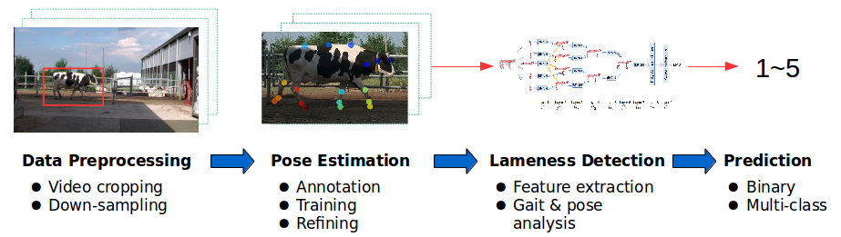
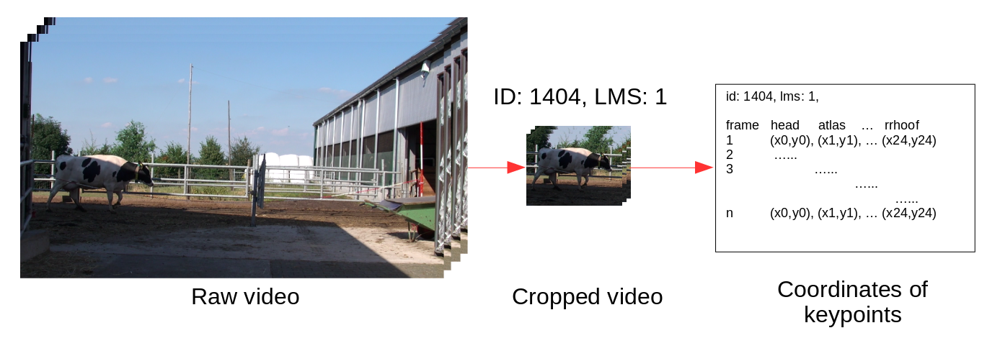
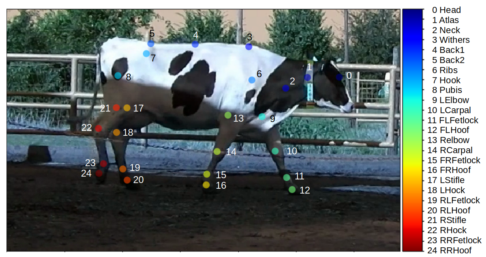
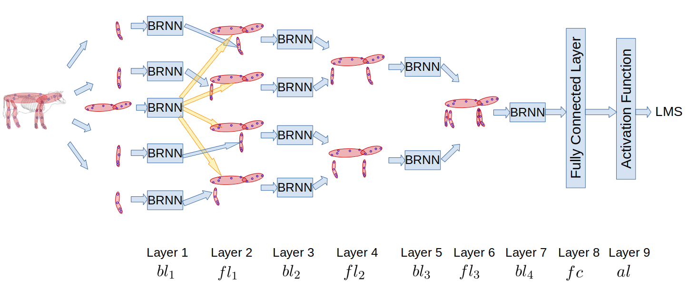
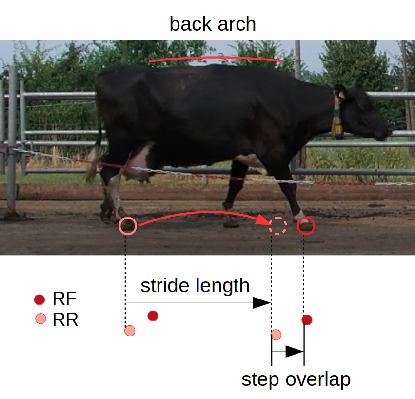
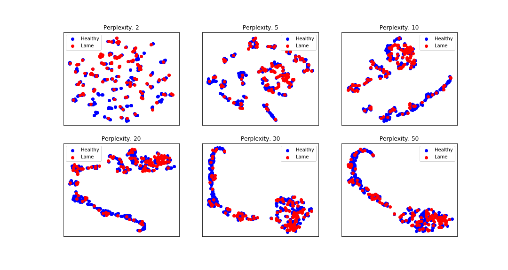

# Lameness Detection

Lameness is a serious disorder on dairy farms that increases the risk of cattle culling and causes significant economic losses. It is traditionally assessed using **locomotion scoring**, which rates a cow's lameness level based on its pose and gait. This project evaluates how well deep neural networks can automate locomotion scoring, compared against other machine learning methods.

<div align="center">
    
</div>

## Table of Contents

- [Data Preparation](#data-preparation)
  - [Video Preprocessing](#video-preprocessing)
  - [Pose Estimation](#pose-estimation)
- [Approach](#approach)
  - [Hierarchical Recurrent Neural Network (HRNN)](#hierarchical-recurrent-neural-network-hrnn)
  - [Random Forest](#random-forest)
  - [HRNN + Random Forest](#hrnn--random-forest)
  - [K-Means Clustering](#k-means-clustering-unsupervised-learning)
- [Results](#results)
- [Discussion](#discussion)
- [Conclusions](#conclusions)
- [Repository Structure](#repository-structure)

## Data Preparation

The raw data consisted of videos (1920×1080, 50 fps, 4–10 minutes each) showing several cows walking individually along a walkway. These videos were preprocessed into skeleton sequences for lameness detection, as shown below.

<div align="center">
    
</div>

### Video Preprocessing

The raw videos were trimmed into 500 shorter clips, each containing a single cow walking from left to right across the frame. Clips were cropped to center the cow and reduce file size, resulting in 680×420 resolution videos at 20 fps.

### Pose Estimation

Cow pose is estimated by extracting 25 keypoints from the body (shown below) using [DeepLabCut](https://github.com/AlexEMG/DeepLabCut), an open-source pose estimation framework. The full process follows the [DeepLabCut Demo](https://github.com/AlexEMG/DeepLabCut/blob/master/examples/Demo_yourowndata.ipynb). Predicted poses were converted from DeepLabCut's HDF output into JSON, forming the skeleton sequence dataset — per-video frames of (x, y) keypoint coordinates in pixels.

<div align="center">
    
</div>

## Approach

A [Hierarchical Recurrent Neural Network (HRNN)](https://www.cv-foundation.org/openaccess/content_cvpr_2015/html/Du_Hierarchical_Recurrent_Neural_2015_CVPR_paper.html) was trained on the skeleton data for lameness detection, with Random Forest and K-Means Clustering used as comparison methods.

### Hierarchical Recurrent Neural Network (HRNN)

The network is based on the idea that actions depend on the movements of individual body parts and their combinations. Coordinates for five body parts are fed into five subnets, and part representations are hierarchically fused as the network depth increases.

<p align="center">
    
</p>

### Random Forest

Several features are hand-crafted from the skeleton data across each sample's time sequence: right/left step overlap, stride length, and back arch (radius from three back keypoints).

<p align="center">
    
</p>

### HRNN + Random Forest

Since HRNN can automatically extract features from skeleton sequences, those learned features are also used to train a Random Forest classifier, in place of the hand-crafted ones.

### K-Means Clustering (Unsupervised Learning)

Given a specified number of centroids (equal to the number of classes), K-Means assigns each sample to the nearest centroid. Manual locomotion scores are used only afterward, to compute accuracy and F1-score against the resulting clusters.

## Results

### HRNN and Its Variants

Three HRNN variants, inspired by the [original HRNN paper](https://www.cv-foundation.org/openaccess/content_cvpr_2015/html/Du_Hierarchical_Recurrent_Neural_2015_CVPR_paper.html), are compared:

- **HBRNN** — Hierarchically Bidirectional RNN
- **HURNN** — Hierarchically Unidirectional RNN
- **DBRNN** — Deep Bidirectional RNN, where a stacked bidirectional RNN is trained on the whole skeleton as input

| Architecture | Accuracy (%) | F1 Score |
| :----------: | :----------: | :------: |
|    HBRNN     |     74.6     |  0.583   |
|    HURNN     |     74.3     |  0.527   |
|    DBRNN     |     73.6     |  0.572   |

### HRNN and Random Forest

Random Forest was trained two ways: with five hand-crafted features (**RF**), and with 80 features from HBRNN's 7th layer (**RF + HBRNN**). Hand-crafted features outperformed HBRNN-derived features for Random Forest training, but HBRNN itself still achieved the best overall accuracy and F1 score.

|   Method   | Accuracy (%) | F1 Score |
| :--------: | :----------: | :------: |
|   HBRNN    |     74.6     |  0.583   |
|     RF     |     69.6     |  0.574   |
| RF + HBRNN |     56.1     |  0.408   |

### K-Means Clustering

Two feature sets were used: raw skeleton sequences and the five hand-crafted features. The high-dimensional skeleton sequences are visualized below using t-SNE. No clear boundary emerges between healthy and lame cows, which likely explains the low clustering accuracy.

|   Features   | Accuracy (%) | F1 Score |
| :----------: | :----------: | :------: |
|   skeleton   |     49.6     |  0.468   |
| hand-crafted |     42.5     |  0.526   |

<p align="center">
    
</p>

## Discussion

1. **Data** — Data amount and quality both matter and are correlated here. Skeleton sequences encode gait and pose as prior knowledge to compensate for limited data, but the sequences are noisy, which hurts detection performance.

2. **Feature extraction** — Lameness detection requires long observation and careful analysis of movement. Lameness features are subtle, and pose changes don't necessarily indicate lameness. Noisy skeleton data makes healthy/lame discrimination difficult, and errors in hand-crafted features can accumulate from that same noise. Keypoint selection may also be a factor.

3. **Method** — HRNN assumes that individual body-part features and their correlations are important for detecting lameness. It could be improved by adding a whole-body stream, so the model learns from overall appearance as well as individual parts.

4. **Unsupervised learning** — K-Means avoids relying on potentially mislabeled manual locomotion scores, but those same scores had to serve as ground truth for evaluation, since no independent validation was available. The clustering result showed healthy and lame cows could not be clearly separated.

## Conclusions

This study assessed the efficacy of deep neural networks (HRNN) against other machine learning methods for automated lameness detection. Without sufficient data, skeleton sequences were used to encode gait and pose as prior knowledge. Deep learning showed promising results overall, though there remains room for improvement in data acquisition, feature selection, and methodology.

## Repository Structure

```
├── doc/                 # Project proposal and data collection protocols
├── img/                 # Figures used in this README
├── src/                 # Notebooks and scripts for training and analysis
│   ├── annotation/      # Data labeling notebook
│   └── object_detection/ # TensorFlow object detection scripts
└── utils/               # Skeleton extraction, visualization, and helper functions
```
